# Seoul Vibe

> 서울의 로컬 장소를 **운영자 큐레이션 아티클**과 **사용자 커뮤니티 피드**로 함께 보여주는 지역 기반 서비스 (한국어 / English)

## 0. 프로젝트 소개 및 기술 스택

Seoul Vibe는 서울의 식당·카페·장소를 두 가지 방식으로 소개합니다. 운영자는 번역을 포함한 추천 아티클을 발행하고, 사용자는 짧은 후기와 이미지, 지도 위치를 직접 공유합니다. 처음 서울을 찾는 사용자에게는 정리된 탐색 경험을, 직접 경험을 남기고 싶은 사용자에게는 간단한 공유 수단을 제공합니다.

- 프론트엔드·백엔드·인프라를 혼자 설계, 구현, 배포한 풀스택 프로젝트
- npm workspaces 모노레포 (`packages/client`, `packages/server`)
- 같은 컨테이너 이미지를 **AWS EKS / GCP GKE(Terraform + Kustomize)** 와 **무료 플랜 서버리스 구성** 두 곳에 배포할 수 있도록 구성

| 구분     | 기술                                                                                   |
| -------- | -------------------------------------------------------------------------------------- |
| Frontend | React, TypeScript, Vite, React Router, Axios, Leaflet(react-leaflet)                   |
| Backend  | NestJS, TypeScript, TypeORM, Passport JWT, bcrypt, Nodemailer, Swagger                 |
| Database | PostgreSQL (Neon / Cloud SQL)                                                          |
| Storage  | 로컬 디스크 / S3 호환 오브젝트 스토리지(Supabase Storage, AWS S3, R2)                  |
| Infra    | Docker, Nginx, Kubernetes(Kustomize), Terraform, AWS EKS, GCP GKE, Render, Cloudflare Pages |
| CI/CD    | GitHub Actions (PR 검증, Pages 자동 배포, keep-warm), Cloud Build                      |
| Test     | Jest, Supertest                                                                        |

## 1. 사용자 및 관리자 화면

### 사용자

| 홈 | 아티클 목록 |
| --- | --- |
| 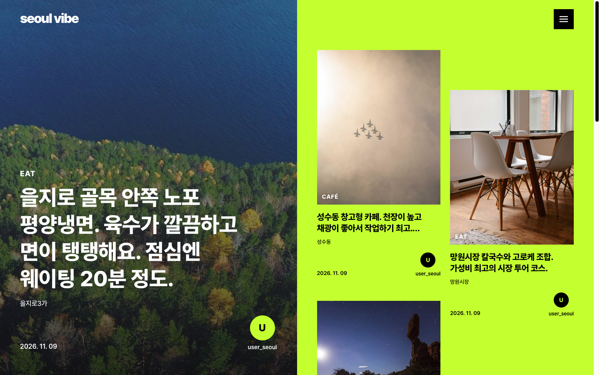 | 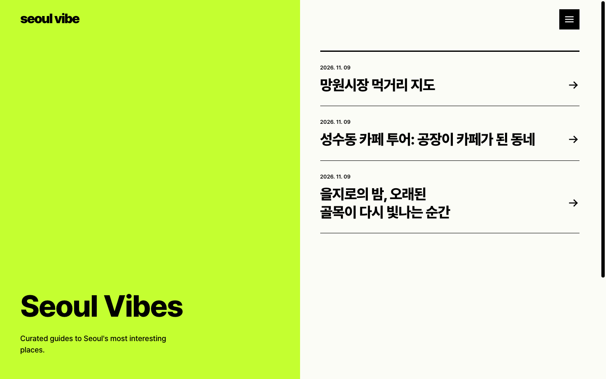 |

| 아티클 상세 | 커뮤니티 피드 |
| --- | --- |
| 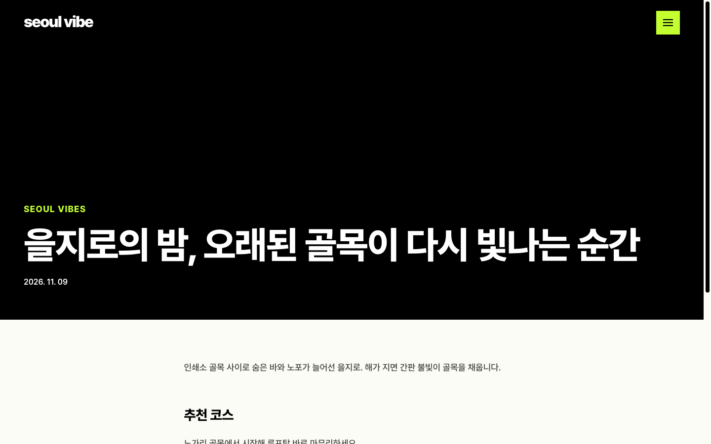 | 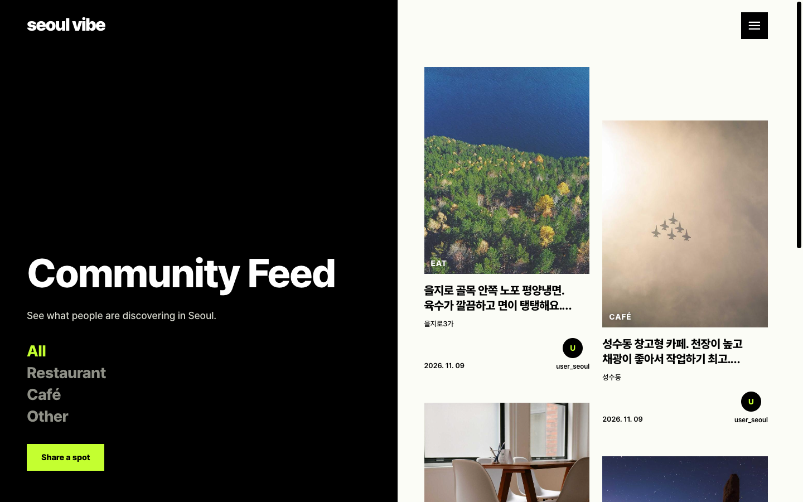 |

| 게시글 작성 (지도 위치 선택) | 로그인 |
| --- | --- |
| 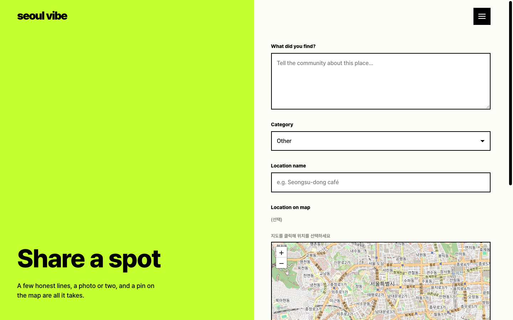 | 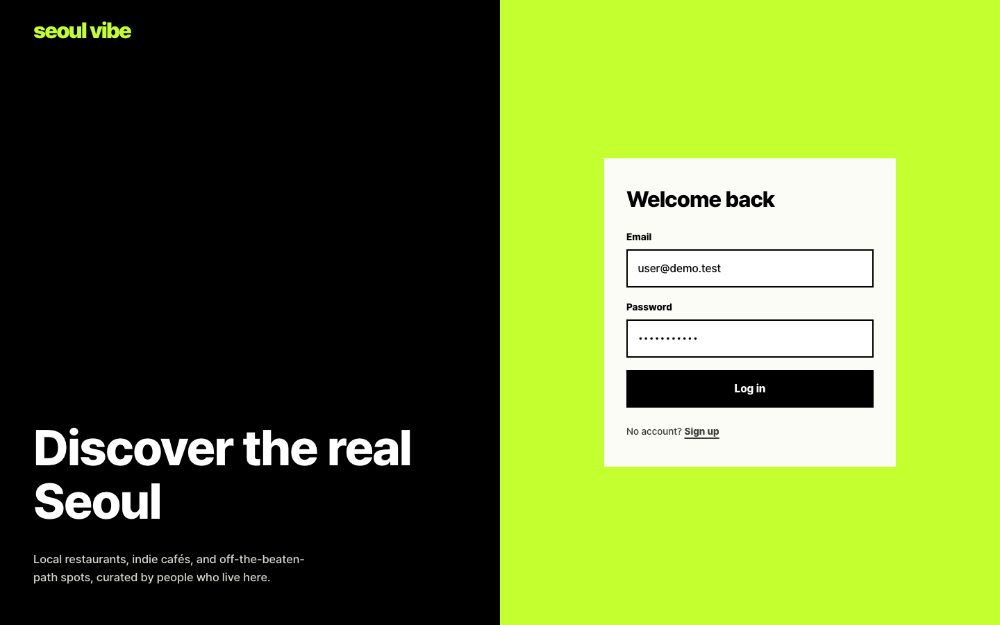 |

| 회원가입 | |
| --- | --- |
| 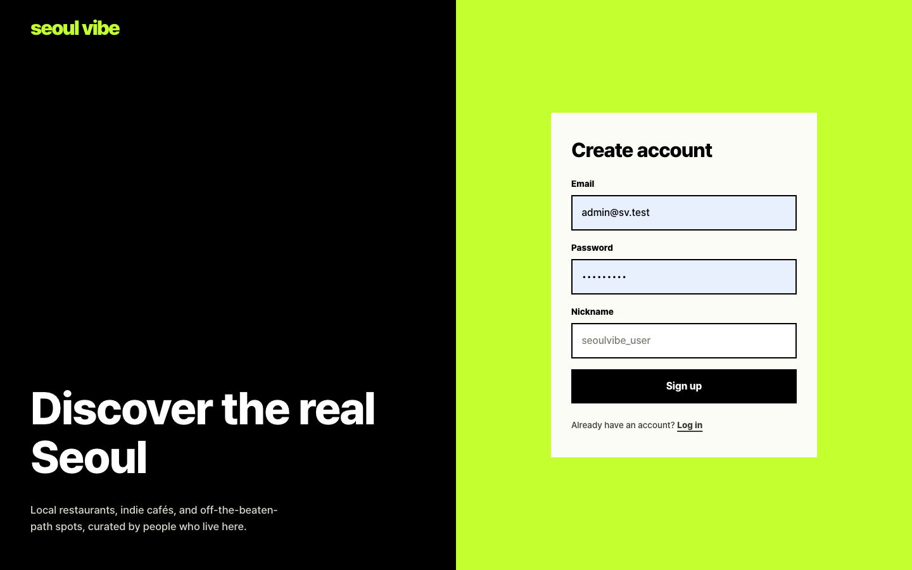 | |

### 관리자 (`/admin`)

| 대시보드 | 사용자 관리 |
| --- | --- |
| 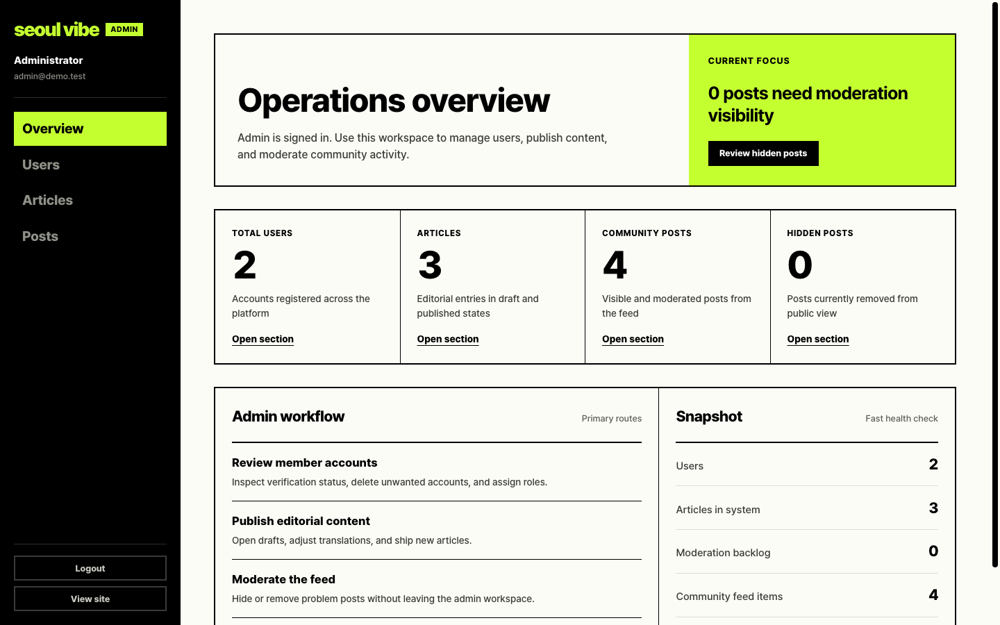 | 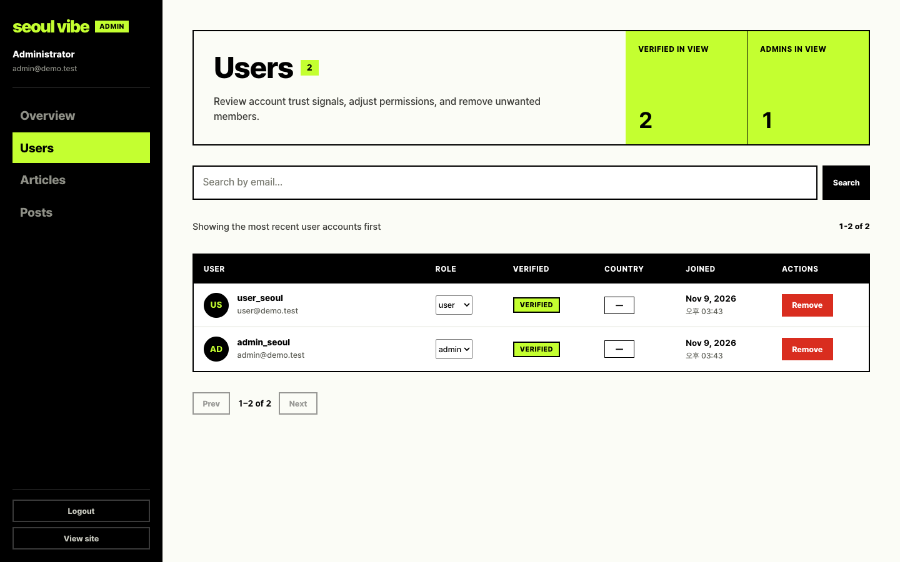 |

| 아티클 관리 | 게시글 관리 |
| --- | --- |
| 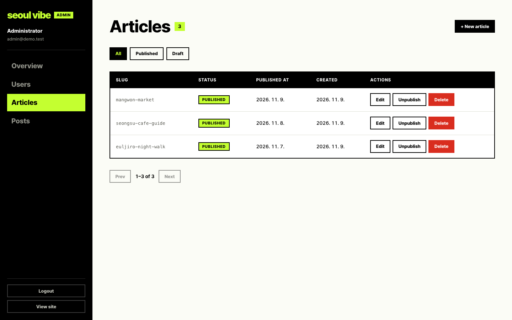 | 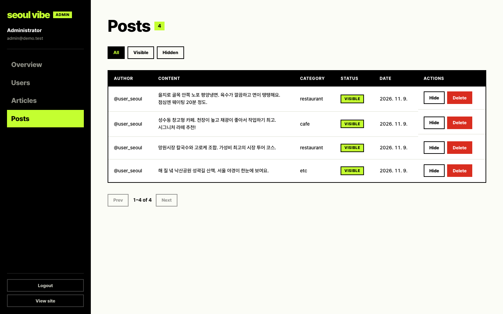 |

## 2. 인프라 구성도

### 운영 (무료 플랜)

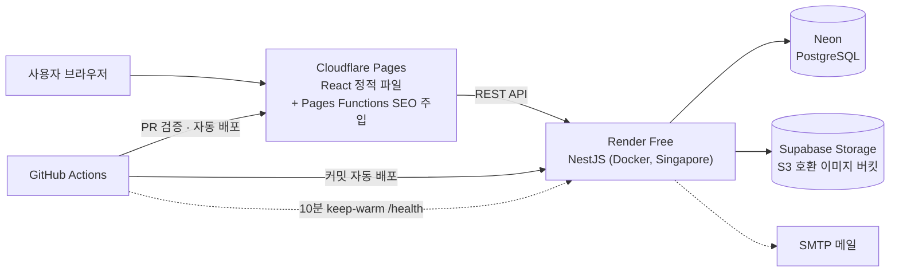

### 클라우드 (Kubernetes)

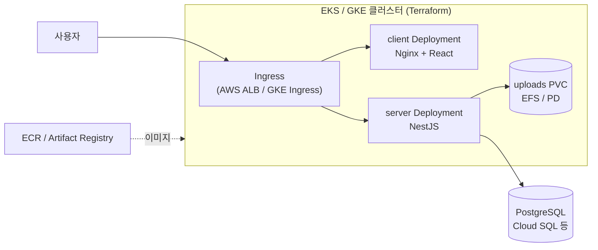

- `k8s/base` + `k8s/overlays/{dev,prod,aws,gcp}` Kustomize 구조로 환경별 설정 분리
- Terraform으로 VPC, 클러스터, 레지스트리, IAM, (AWS) ALB Controller·EFS, (GCP) Cloud SQL 프로비저닝

## 3. 주요 기능

**사용자**

- 회원가입 · 로그인 · **이메일 인증**, Access/Refresh **JWT** 토큰 재발급
- 운영자 아티클 탐색 (카테고리, 출처 표시, Instagram 임베드)
- 커뮤니티 피드: 식당·카페·장소 후기 작성/수정, 이미지 업로드, **Leaflet 지도로 위치 선택**
- `/:lang` URL 기반 **한국어/영어 다국어**, 콘텐츠 번역 구조

**관리자**

- **역할 기반 접근 제어** (`RolesGuard`, `AdminRoute`)
- 사용자 · 아티클 · 게시글 관리

**플랫폼**

- Cloudflare Pages Functions에서 SEO 메타 조각을 주입하는 **SSR 없는 SEO** 처리
- 스토리지 드라이버 추상화로 로컬 디스크 ↔ S3 호환 스토리지 전환
- 공통 응답 인터셉터, 전역 예외 필터, 요청 로깅

## 참고 링크

- [클라이언트 앱](./packages/client) · [서버 앱](./packages/server)
- [AWS EKS Terraform](./terraform/aws/eks/README.md) · [GCP GKE Terraform](./terraform/gcp/gke/README.md)
- [무료 배포 가이드](docs/deployment/free-render-neon-cloudflare.md)
